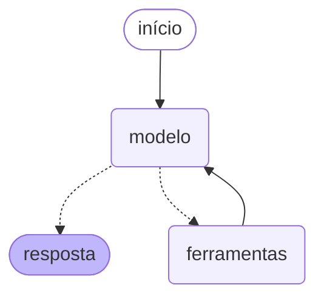

# Assistente RAG + Agente com Function Calling

Assistente de perguntas e respostas sobre documentos próprios (PDF e TXT),
construído em duas camadas:

1. **RAG** — recuperação semântica em base vetorial local, para responder
   com base nos documentos em vez do conhecimento geral do modelo.
2. **Agente** — camada de *function calling* onde o modelo **decide** qual
   ferramenta usar a cada pergunta, executa em sequência quando necessário,
   e mantém o contexto ao longo da conversa.

O projeto foi construído incrementalmente: primeiro o RAG puro, depois o
loop de agente escrito à mão, e só então formalizado em LangGraph. As três
versões continuam no repositório de propósito — a comparação entre elas é
parte do que o projeto demonstra.

---

## O que este projeto demonstra

| Competência | Onde está |
|---|---|
| RAG completo (chunking, embeddings, vector DB, retrieval) | `carregador.py`, `base_vetorial.py`, `rag.py` |
| Function calling / tool use | `ferramentas.py`, `agente.py` |
| Loop de agente implementado do zero | `agente.py` |
| Framework de agentes (LangGraph) | `agente_grafo.py` |
| Memória de conversa | classe `Conversa` e checkpointer do LangGraph |
| Citação de fontes na resposta | `buscar_com_fontes()` |
| OCR para documentos escaneados | `carregador.py` |
| Projeto agnóstico de fornecedor de LLM | `.env` (`OPENAI_BASE_URL`) |

---

## Arquitetura



O ciclo em cinco passos:

1. A conversa e a lista de ferramentas são enviadas ao modelo.
2. O modelo devolve uma resposta em texto **ou** um pedido de chamada de
   ferramenta.
3. Se pediu ferramenta, **a aplicação** executa a função — o modelo nunca
   executa nada.
4. O resultado volta ao modelo como mensagem de papel `tool`.
5. O modelo decide de novo: responder ou chamar outra ferramenta.

A aresta que volta de `ferramentas` para `modelo` é o que caracteriza um
agente. Sem ela, seria apenas uma chamada única de LLM.

---

## As ferramentas

O agente escolhe entre quatro. Ter mais de uma é o ponto: com apenas uma,
não existe decisão a tomar.

| Ferramenta | Função | Detalhe de implementação |
|---|---|---|
| `buscar_documentos` | Busca semântica na base vetorial | Retorna texto **e** origem, permitindo citar a fonte |
| `calcular` | Avalia expressões aritméticas | Parser com `ast`, não `eval` — a expressão vem de um LLM que recebe input do usuário |
| `data_atual` | Data e hora em Brasília | O modelo não sabe a data; sem isso ele inventa |
| `dias_entre_datas` | Diferença entre duas datas | Criada após observar o agente errar cálculos de calendário |

---

## Decisões técnicas e problemas resolvidos

### Chunking por fronteira semântica, não por contagem de caracteres

A implementação inicial fatiava o texto a cada N caracteres
(`texto[inicio:fim]`), produzindo chunks que começavam no meio de palavras.
Um pedaço truncado gera um embedding que representa mal o conteúdo, e a
busca deixa de encontrar informação que está no documento.

A versão atual quebra por parágrafo, depois por frase, e só corta dentro de
uma palavra em último caso (URL longa, ruído de OCR).

### Modelo de embedding multilíngue

O ChromaDB usa por padrão o `all-MiniLM-L6-v2`, treinado majoritariamente
em inglês. Com documentos técnicos em português — cheios de siglas — a
recuperação degradava de forma clara.

**Antes e depois**, mesma pergunta, mesma base:

| | Antes | Depois |
|---|---|---|
| Busca por uma sigla presente no documento | trechos de uma tabela de códigos, sem relação | três trechos do documento correto |
| Resposta do agente | "não consta nos documentos indexados" | resposta estruturada, com a fonte citada |

O provedor de embedding é configurável (`PROVEDOR_EMBEDDING`): API,
modelo local multilíngue, ou o padrão do Chroma para comparação.

### Tool use corrige o cálculo, não o raciocínio

Perguntado quantos dias faltavam para o fim do ano, o agente consultou a
data corretamente e então montou a expressão aritmética usando o *número do
mês* onde deveria usar o *dia*. A ferramenta `calcular` executou a conta
sem erro — a conta é que estava errada.

A correção não foi ajustar o prompt, e sim **elevar o nível da ferramenta**:
`dias_entre_datas` resolve o problema inteiro com a aritmética de datas do
Python, em vez de pedir ao modelo que a decomponha.

### Poda de histórico que não quebra a conversa

Como a API é sem estado, a conversa inteira é reenviada a cada chamada, e o
histórico precisa ser podado. Mas uma mensagem com `tool_calls` e seus
resultados `tool` formam um bloco indivisível: cortar no meio deixa uma
chamada órfã e a API rejeita a requisição.

A poda só corta imediatamente antes de uma mensagem de usuário — ponto que
nunca parte um bloco de ferramenta. A instrução de sistema fica fixa e
nunca é descartada.

### Configuração fora do código

Caminhos de OCR e credenciais vêm do `.env`, com fallback para o `PATH` do
sistema. Um caminho absoluto fixo no fonte impede que o projeto rode em
outra máquina — e publica o login do autor no repositório.

---

## Estrutura

```
assistente-rag/
├── app.py                  # interface Streamlit
├── requirements.txt
├── .env.example            # variáveis necessárias (copie para .env)
├── documentos/             # seus PDFs e TXTs (não versionado)
├── documentos_exemplo/     # documentos públicos, versionados
├── chroma_db/              # base vetorial (não versionado)
├── cache_texto/            # texto extraído por OCR (não versionado)
└── src/
    ├── carregador.py       # leitura de PDF/TXT, OCR e chunking
    ├── base_vetorial.py    # embeddings e ChromaDB
    ├── gerador.py          # geração via LLM local (modo RAG puro)
    ├── rag.py              # pipeline de RAG puro
    ├── reindexar.py        # reconstrói a base do zero
    ├── ferramentas.py      # as tools, no schema da API
    ├── agente.py           # loop de function calling + memória
    └── agente_grafo.py     # o mesmo agente, em LangGraph
```

---

## Como rodar

```bash
# 1. ambiente e dependências
python -m venv .venv
.venv\Scripts\activate           # Linux/macOS: source .venv/bin/activate
python -m pip install -r requirements.txt

# 2. configuração
copy .env.example .env           # depois edite com sua chave

# 3. indexe os documentos
#    documentos_exemplo/ já vem com material público do Ministério da Saúde;
#    coloque seus próprios arquivos em documentos/ (pasta não versionada).
python src/reindexar.py

# 4. converse com o agente
python src/agente.py             # loop implementado à mão
python src/agente_grafo.py       # o mesmo, em LangGraph
python src/rag.py                # modo RAG puro, para comparação
```

Para PDFs escaneados é necessário **Tesseract** (com o pacote de idioma
português) e **Poppler**; informe os caminhos no `.env`.

---

## Stack

**Python** · **ChromaDB** (base vetorial) · **OpenAI API** (agente e
embeddings) · **LangGraph** (orquestração) · **Streamlit** (interface) ·
**Tesseract/Poppler** (OCR) · **Ollama** (LLM local, no modo RAG puro)

A camada de agente usa o formato de API da OpenAI, mas o endpoint é
configurável por variável de ambiente — Groq, Gemini e Ollama local
funcionam trocando uma linha do `.env`, sem alteração de código.

---

## Próximos passos

- [ ] Reranking dos chunks recuperados
- [ ] Métricas de avaliação de RAG (precisão do retrieval, fidelidade da resposta)
- [ ] Ferramenta de busca exata para tabelas de código, onde a busca
      semântica é inadequada por natureza
- [ ] Interface Streamlit com o agente (hoje ela usa o RAG puro)
- [ ] Testes automatizados das ferramentas